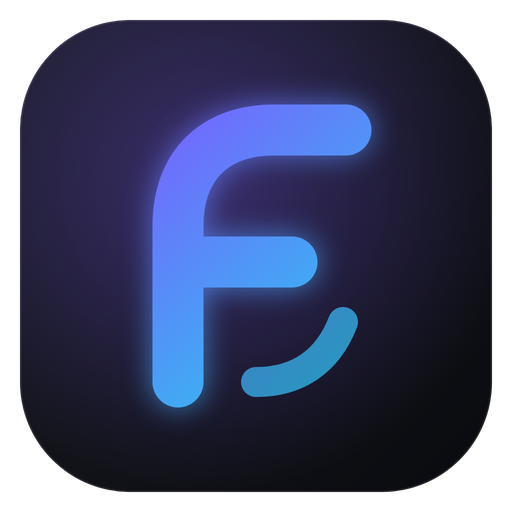

<p align="center"></p>

<h1 align="center">Flow Browser</h1>

<p align="center">A dark, fast desktop web browser for Windows with a built-in ad blocker, side panel apps and Discord status.<br>
Made by flowifys. Built with Electron.</p>

## Download

Grab **FlowBrowserSetup-1.3.0.exe** from the [Releases](../../releases) page and run it. Windows may show a SmartScreen warning because the installer isn't code-signed: click **More info → Run anyway**.

## Features

- **Ad and tracker blocking** built in (Ghostery's blocker).
- **Side panel apps** that stay open next to your tabs: Discord, Spotify, WhatsApp, Telegram, YouTube Music, Twitch, Instagram, Messenger, X, TikTok, Claude and ChatGPT.
- **Spotify mini player:** Spotify keeps playing with the panel closed, and the toolbar shows the song with play and skip buttons.
- **Protected music plays** (like Spotify), using castlabs' Electron build with Widevine.
- **Discord Rich Presence:** shows "Watching YouTube", "Listening on Spotify" and so on, on your Discord profile. It's off until you turn it on in Settings and paste in the Application ID of a Discord app (Settings explains how). You can also hide page titles.
- **Flow VPN:** routes your tabs through the Tor network, with a choice of country. The first time you turn it on, it downloads the official Tor Expert Bundle from torproject.org and checks it against Tor's published checksum. Side panel apps stay on your normal connection.
- **Search:** Flow Search (its own results page), DuckDuckGo, Brave Search, Startpage, Google or Bing, with suggestions as you type.
- **Google sign-in works** (Google blocks most Electron browsers; Flow shows its sign-in pages a Firefox user agent).
- **Seven themes:** Midnight, Graphite, Abyss, Plum, Forest, Ember and OLED Black.
- Private tabs, bookmarks, history, downloads, find on page, zoom, and a custom new tab page.

### Keyboard shortcuts

| Keys | Does |
| --- | --- |
| Ctrl+T / Ctrl+W | New tab / close tab |
| Ctrl+Shift+T | Reopen closed tab |
| Ctrl+Shift+N | New private tab |
| Ctrl+Tab / Ctrl+Shift+Tab | Next / previous tab |
| Ctrl+L, F6 or Alt+D | Go to the address bar |
| Ctrl+R or F5 / Ctrl+Shift+R | Reload / hard reload |
| Alt+Left / Alt+Right / Alt+Home | Back / forward / new tab page |
| Ctrl+D | Bookmark this page |
| Ctrl+H / Ctrl+J / Ctrl+Shift+O | History / downloads / bookmarks |
| Ctrl+F | Find on page |
| Ctrl+= / Ctrl+- / Ctrl+0 | Zoom in / out / reset |
| Ctrl+P / Ctrl+S | Print / save page |
| F11 / F12 | Full screen / developer tools |

## Running it from the source

You need [Node.js](https://nodejs.org) 20 or newer.

```bash
npm install
npm start
```

## Building the installer

```bash
npm run dist
```

The installer ends up in `dist/` as `FlowBrowserSetup-<version>.exe`. To change the version, edit `"version"` in `package.json`.

## Project layout

| Folder | What's in it |
| --- | --- |
| `src/main/` | The main process: windows and tabs (`main.js`), settings (`store.js`), search engines, side panel apps and themes (`data.js`), ad blocking, Discord status (`rpc.js`), Flow Search (`search.js`) and Flow VPN (`vpn.js`) |
| `src/ui/` | The browser's own interface: tabs, toolbar and side panel |
| `src/pages/` | The `flow://` pages: new tab, search, settings, history, bookmarks, downloads and errors |
| `src/preload/` | The bridges between those pages and the main process |
| `build/` | The app icon |
| `tools/` | Helper scripts: drawing the icon (`make-icon.js`), stamping the icon into the exe (`stamp.js`) and a screenshot test (`test.js`) |
